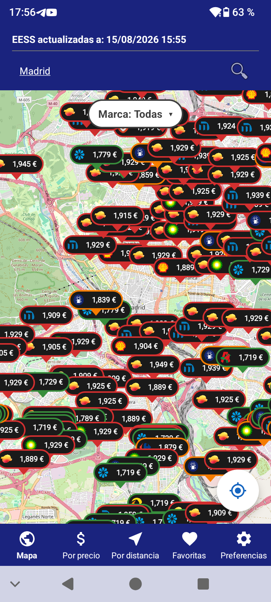
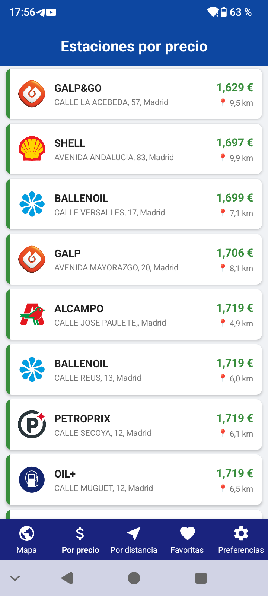
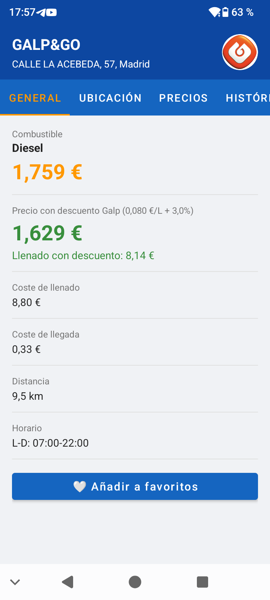

# ⛽ AhorraGas

**Encuentra la gasolinera más barata cerca de ti y calcula cuánto ahorras de verdad**, con los precios oficiales del Ministerio, tu vehículo y tus descuentos.

  &nbsp;
  &nbsp;
  

## Qué puedes hacer con AhorraGas

- **Ver en un mapa** las gasolineras y puntos de recarga eléctrica de España, con su precio actual.
- **Ordenarlas por precio o por distancia** y buscar por localidad.
- **Calcular el coste real** de repostar según el consumo de tu vehículo y los descuentos de cada marca.
- **Consultar el histórico de precios**, las promociones y las opiniones de cada estación.
- **Recibir alertas** cuando el precio baje del umbral que elijas.
- **Guardar tus favoritas**, sin registrarte ni crear ninguna cuenta.

## Disponibilidad

Próximamente en Google Play.

## Información

- [Política de privacidad](privacy-policy)
- Contacto: [ahorragas.soporte@gmail.com](mailto:ahorragas.soporte@gmail.com)
- [Código fuente en GitHub](https://github.com/Anticlub/AhorraGas)

---

Proyecto desarrollado por Cristofer Fernández Fernández, Marco Calvo Méndez y Raúl González-Gallego López-Menchero.